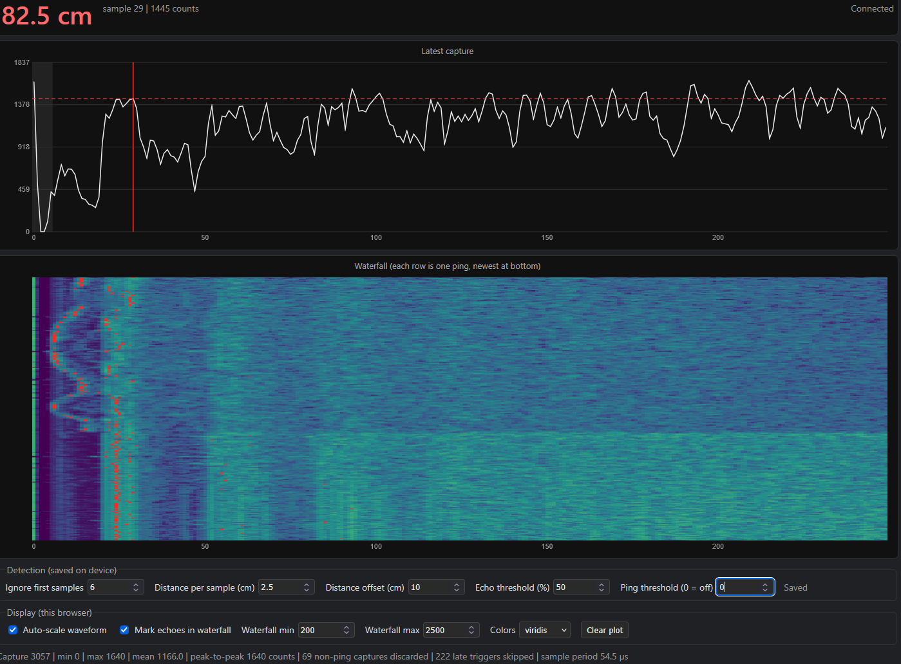

# ESP32-S3 Lucky Finder web viewer

**All this ESP32-based code is purely vibe-coded slop. Do not expect things to work or be done well.**

A standalone version of the ESP32 SuperMini sketch and the [ESP32 Python viewer](../../TUSS4470_shield_002/esp32_interface.py), made for the **ESP32-S3 SuperMini**. The ESP32 captures each ping, discards non-ping triggers, finds the first echo and hosts a web page with the waveform, waterfall, distance readout and all settings. No PC software is needed; any phone or computer with a browser works.

The S3 has two cores: WiFi runs on one and the trigger interrupt and sampling on the other, so network traffic does not disturb the captures. The sketch still builds for the ESP32-C3 SuperMini (single core) with the same wiring.


Moving a small object in front of the sensor, with 80cm being the depth of the container.

## Wiring

Same GPIO numbers as [ESP32_lucky_finder.ino](../ESP32_lucky_finder/ESP32_lucky_finder.ino):

| ESP32-S3 pin | Function |
|---|---|
| GPIO1 | Trigger input, a capture starts on each falling edge |
| GPIO4 | Echo signal (ADC). Use an ADC1 pin (S3: GPIO1–10); ADC2 does not work while WiFi is on. |

Both are 3.3 V pins. Avoid the strapping pins GPIO0, 3, 45 and 46.

## Upload

1. In the Arduino IDE, install the **esp32** board package (tested with 3.3.12).
2. Open [ESP32_lucky_finder_web.ino](ESP32_lucky_finder_web.ino) and select **Tools → Board → ESP32S3 Dev Module**.
3. Set **Tools → USB CDC On Boot → Enabled** so serial output goes over the SuperMini's USB port. The other defaults (4MB flash, PSRAM disabled) work on the SuperMini.
4. Optionally edit the WiFi settings at the top of the sketch, then upload. If the upload does not start, hold **BOOT**, tap **RST**, release **BOOT** and upload again.

Command line equivalent:

```bash
arduino-cli compile --fqbn esp32:esp32:esp32s3:CDCOnBoot=cdc ESP32_lucky_finder/ESP32_lucky_finder_web
arduino-cli upload  --fqbn esp32:esp32:esp32s3:CDCOnBoot=cdc -p COM4 ESP32_lucky_finder/ESP32_lucky_finder_web
```

For the ESP32-C3 SuperMini, use the board **ESP32C3 Dev Module** (`esp32:esp32:esp32c3:CDCOnBoot=cdc`) instead.

## Connecting

- **Access point (default):** join the WiFi network `OpenEcho` (password `openecho`) and open <http://192.168.4.1/>. Change `AP_PASSWORD` in the sketch for your own setup.
- **Existing network:** set `WIFI_SSID` and `WIFI_PASSWORD` in the sketch. The ESP32 then joins that network and is reachable at <http://openecho.local/> or at the IP address printed on the serial monitor. If it cannot connect within 15 s, it starts the access point instead.

If an ESP32-C3 SuperMini fails to connect, adding `WiFi.setTxPower(WIFI_POWER_8_5dBm);` after `WiFi.mode(...)` in `startWifi()` often helps.

## Moving from the ESP32-C3

The ADC counts and sample period differ between the C3 and S3, so check the calibration after switching:

- **Ping threshold:** if the status line says "No pings accepted yet" and the discarded count keeps rising, lower it. A good value is between the first-sample levels of real pings and of noise triggers. Set it to 0 temporarily to see both in the waveform.
- **Distance per sample:** check the sample period on the status line and recalibrate against a known distance. Waterfall levels may also need adjusting.

## Settings

Detection settings are stored on the ESP32 and survive restarts. Changes apply immediately, including to the latest capture.

| Setting | Default | Description |
|---|---|---|
| Ignore first samples | 6 | Blind spot (transmit ring-down) that is never treated as an echo. |
| Distance per sample (cm) | 2.5 | `distance = sample index × distance per sample + offset`. |
| Distance offset (cm) | 10 | See above. Defaults are a rough calibration: sample 20 ≈ 60 cm, sample 30 ≈ 85 cm. |
| Echo threshold (%) | 50 | The first echo is the first peak reaching this percentage of the way from the baseline (median) to the strongest reading. Lower it to catch weaker near echoes; raise it if noise is picked up. |
| Ping threshold (0 = off) | 1700 | Captures whose first 4 samples average below this many ADC counts are discarded. This removes the extra noise trigger that arrives with every ping. |

Display settings (auto-scale, waterfall levels, colours, echo markers) are stored per browser.

The status line shows the measured **sample period**. Distance per sample is `speed of sound × sample period / 2`. For example, 34 µs in water (1480 m/s) is about 2.5 cm per sample.

## Serial output

The sketch still prints every raw capture as an `sp...` line over USB serial, so [esp32_interface.py](../../TUSS4470_shield_002/esp32_interface.py) keeps working. Set `SERIAL_STREAM` to `false` to turn this off.

## Endpoints

| Path | Description |
|---|---|
| `GET /` | Web interface |
| `GET /data?since=N` | JSON with the newest first echo, counters, sample period and accepted captures with sequence number greater than `N` (up to the last 8) |
| `GET /settings` | Current detection settings as JSON |
| `POST /settings` | Update settings with form fields `blind`, `dps`, `offset`, `echoPct`, `pingThr` |
